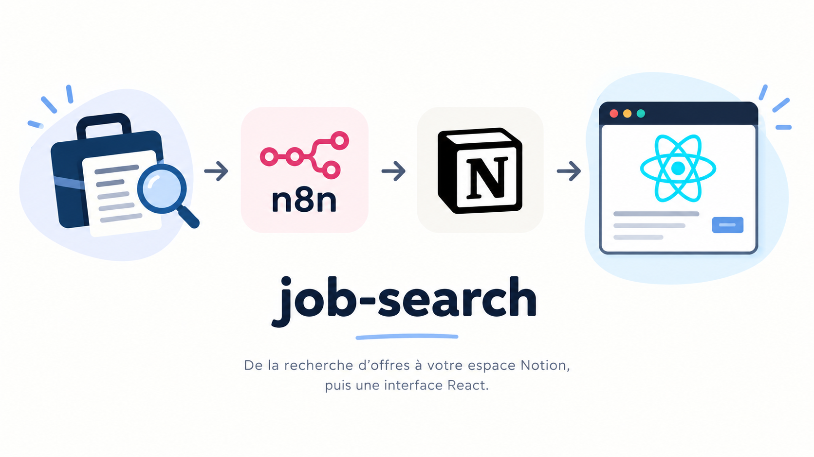

# Suivi des offres d'emploi (Notion + Next.js/TypeScript)



Site React (Next.js, App Router, TypeScript) qui lit une base de données Notion
et affiche :

- une **page d'accueil** avec les infos essentielles de chaque offre (titre,
  entreprise, localisation, contrat, salaire, source, score, correspond) et
  une recherche ;
- une **page de détail** (clic sur une ligne) avec tous les champs :
  compétences matchées / manquantes / à améliorer, raison, conseils, lien
  vers l'annonce.

Le token Notion reste **côté serveur uniquement** (Server Components), il
n'est jamais exposé au navigateur.

## Récupération des offres (workflow n8n)

Les offres sont récupérées automatiquement par un **workflow n8n** qui
s'exécute **tous les jours de la semaine, sauf le samedi et le dimanche**
(du lundi au vendredi). Le workflow :

1. lit sur Strapi les compétences, le type d'emploi recherché et la ville ;
2. interroge les API d'offres d'emploi (JSearch et France Travail) ;
3. fait correspondre les compétences avec chaque poste via DeepSeek ;
4. enregistre les offres dans la base Notion ;
5. envoie une notification sur Discord.

Il se trouve dans le dossier `n8n`, dans le fichier **recherche offre.json**
(à importer dans n8n).

### Variables d'environnement n8n

| Variable | Rôle |
| --- | --- |
| `STRAPI_URL` | URL de Strapi, pour récupérer les compétences, l'emploi recherché et la ville de recherche |
| `STRAPI_TOKEN` | Token pour se connecter à Strapi |
| `JSEARCH_API_KEY` | Clé pour utiliser l'API de recherche d'emploi JSearch |
| `FRANCE_TRAVAIL_CLIENT_ID` | Client ID pour se connecter à l'API France Travail |
| `FRANCE_TRAVAIL_CLIENT_SECRET` | Client secret pour se connecter à l'API France Travail |
| `NOTION_TOKEN` | Token pour se connecter à la base de données Notion |
| `NOTION_BDD_URL` | URL de la base de données Notion |
| `DEEPSEEK_API_KEY` | Clé API DeepSeek, pour le match entre les compétences et le poste |
| `DISCORD_WEEBHOOK_OFFRE_EMPLOI` | Webhook Discord pour envoyer le message des nouvelles offres |
| `JOB_SEARCH_URL` | URL du site job-search |

### Configuration de Strapi

Strapi contient 2 **Collection Types** à créer, lus par le workflow n8n :

**`RechercheEmploi`** : l'emploi recherché

| Champ | Type | Rôle |
| --- | --- | --- |
| `intituler` | Text | Poste recherché |
| `ville` | Text | Ville de recherche |

**`Competence`** : les compétences

| Champ | Type | Rôle |
| --- | --- | --- |
| `type_competence` | Text | Catégorie de la compétence (langage de programmation, data, etc.) |
| `title` | Text | Nom de la compétence |
| `library_icon` | Text | Librairie de l'icône à utiliser |
| `icon` | Text | Icône à utiliser |
| `note` | Number | Niveau d'aisance avec la compétence |

## 1. Créer l'intégration Notion (si pas déjà fait)

1. Aller sur https://www.notion.so/my-integrations et créer une intégration
   interne ("New integration").
2. Copier le **token** généré (commence par `secret_` ou `ntn_`).
3. Ouvrir la base de données dans Notion → menu `•••` en haut à droite →
   **Connections** → connecter l'intégration à la base (sinon l'API
   renverra une erreur 404 "object_not_found").
4. Récupérer l'**ID de la base** : dans l'URL
   `https://www.notion.so/xxxxxxxx<ID_DE_32_CARACTERES>?v=...`, l'ID est le
   bloc de 32 caractères juste après le nom de l'espace de travail.

## 2. Colonnes attendues dans la base Notion

Les noms de propriétés doivent correspondre exactement (peu importe le type
de propriété Notion utilisé — texte, select, multi-select, number, url...) :

```
id_offre, titre, entreprise, localisation, contrat, salaire, source, url,
score, correspond, competences_matchees, competences_manquantes,
competences_a_ameliorer, raison, conseils
```

Pour les 3 colonnes de compétences, utiliser idéalement une propriété
**multi-select**, mais du texte séparé par des virgules fonctionne aussi.

## 3. Installation

```bash
npm install
cp .env.local.example .env.local
```

Éditer `.env.local` :

```
NOTION_TOKEN=secret_xxx...
NOTION_DATABASE_ID=xxxxxxxxxxxxxxxxxxxxxxxxxxxxxxxx
```

| Variable | Rôle |
| --- | --- |
| `NOTION_TOKEN` | Token de l'intégration Notion, pour lire la base de données (côté serveur uniquement) |
| `NOTION_DATABASE_ID` | ID de la base de données Notion contenant les offres |

## 4. Lancer le site

```bash
npm run dev
```

Ouvrir http://localhost:3000

## 5. Build production

```bash
npm run build
npm run start
```

## Structure du projet

```
src/
  app/
    page.tsx              # page d'accueil (liste des offres)
    offres/[id]/page.tsx   # page de détail d'une offre
    layout.tsx, globals.css
  components/
    OffresTable.tsx        # tableau cliquable + recherche
    Badge.tsx, TagList.tsx
  lib/
    notion.ts               # client Notion + mapping des propriétés
    types.ts                 # type Offre
    format.ts                # helpers d'affichage (couleurs de score, etc.)
```
